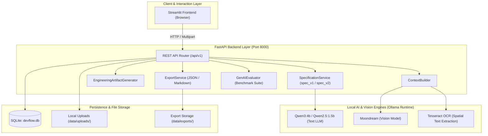
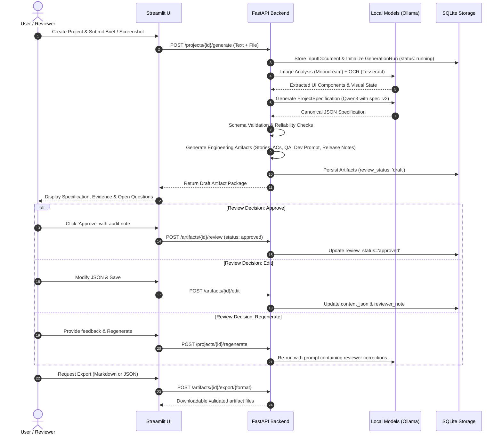
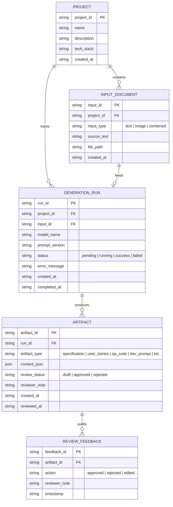

# DevFlow Copilot Architecture & System Design

## 1. System Overview
**MoinSystems AI DevFlow Copilot** is a local-first Generative AI software development pipeline designed specifically for software houses and development agencies. It converts raw, unstructured client inputs (text briefs, meeting transcripts, wireframe screenshots, diagrams) into machine-validated, developer-ready delivery artifacts.

### Guiding Principles:
1. **Zero-Paid-API Rule**: 100% free and open-source local execution (FastAPI, Streamlit, Ollama, Qwen open models, Moondream, Tesseract OCR, SQLite).
2. **Evidence Fidelity & Anti-Hallucination**: Observable UI facts (`observed`) are strictly isolated from inferred behaviors (`assumed`) and missing details (`open_questions`).
3. **Mandatory Human-in-the-Loop Review Gate (`GEN-008`)**: All generated artifacts default to `draft` and cannot be approved or deployed autonomously.
4. **End-to-End Traceability (`GEN-003`, `GEN-007`)**: Every artifact links to input documents, generation run metadata, model checkpoint, prompt version, and human review decisions.

---

## 2. Logical Architecture Diagram

---

## 3. End-to-End Workflow Diagram

---

## 4. Entity-Relationship Diagram (ERD)

